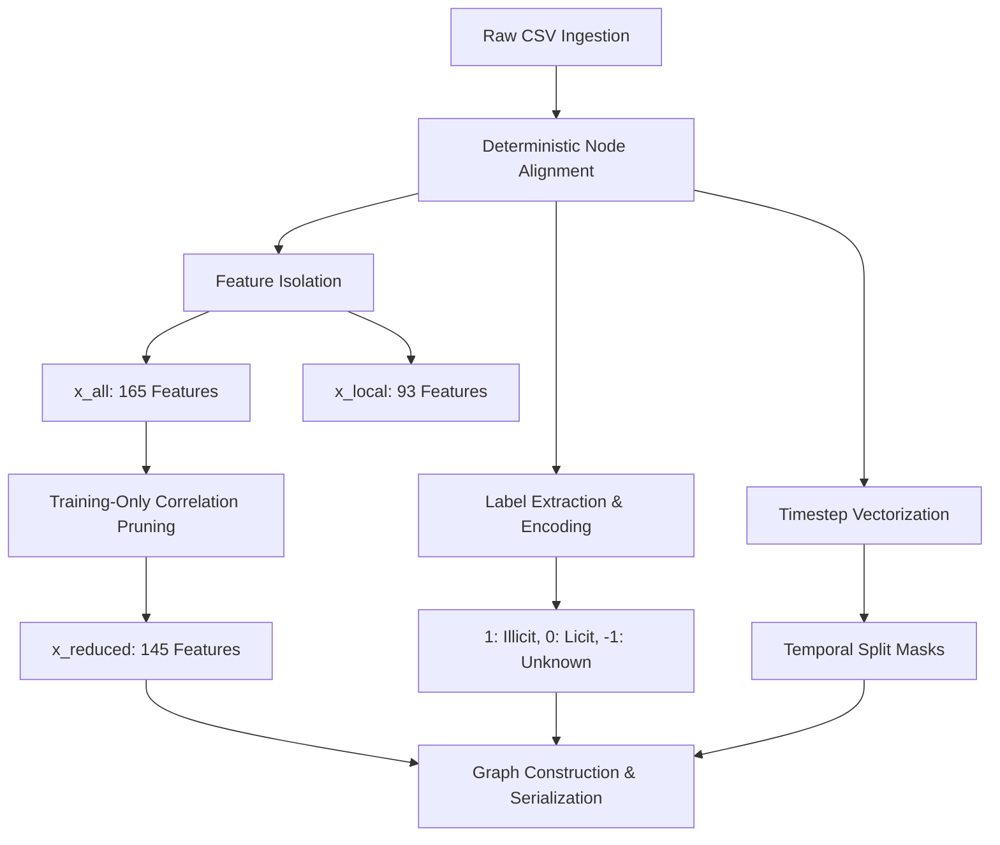

# Phase 1 Technical Report: Dataset Engineering, Preprocessing, and Graph Construction

**Project Title:** AI-Powered Cryptocurrency Anti-Money Laundering Using Graph Neural Networks  
**Repository:** [https://github.com/bhanuprakashpindi-creator/crypto-aml-gnn-phase1](https://github.com/bhanuprakashpindi-creator/crypto-aml-gnn-phase1)  
**Phase:** Phase 1 of 4  
**Primary Author/Engineer:** Pindi Bhanu Prakash  
**Document Version:** 1.0.0  
**Verification Date:** October 26, 2026  

---

## 1. Executive Summary

Cryptocurrency networks have emerged as a primary conduit for illicit financial flows, including ransomware payments, sanctions evasion, darknet market operations, and multi-layered money laundering schemes. The pseudonymous and highly dynamic nature of blockchain networks presents severe challenges for conventional Anti-Money Laundering (AML) frameworks. Traditional rule-based alerting and standard tabular machine learning approaches evaluate transactions in isolation or through static feature engineering, ignoring the rich relational topology encoded in cryptocurrency transaction graphs.

Graph Neural Networks (GNNs) provide a principled paradigm for learning directly from transaction graphs. By combining local node features with multi-hop topological message passing, GNNs can uncover complex structural patterns—such as pass-through layering, peel chains, and synthetic mixing cycles—that evade conventional transactional analysis.

This technical report details the complete engineering and experimental foundation developed during **Phase 1** of our four-phase research initiative. Phase 1 is strictly responsible for:
1. End-to-end ingestion and structural integrity validation of the Elliptic Bitcoin Transaction Dataset.
2. Leakage-free node alignment, target encoding, and training-restricted feature engineering.
3. Graph construction and format conversion compatible with PyTorch Geometric (`edge_index`, `Data` containers, and raw PyTorch tensors).
4. Temporal graph partitioning into chronologically sound training, validation, and test splits.
5. Automated unit testing, serialization of reproducible data artifacts, and comprehensive technical documentation.

> **CRITICAL ARCHITECTURAL BOUNDARY:** Phase 1 establishes the clean dataset, topological structures, and leakage audits. Phase 1 does **not** train classification models, does not tune hyperparameters, and does not establish project-specific detection performance scores. Downstream modeling and empirical evaluations are reserved exclusively for Phase 2 (Random Forest Baseline), Phase 3 (Graph Neural Networks & Chebyshev Models), and Phase 4 (Streamlit Forensic Dashboard).

---

## 2. Problem Statement

### 2.1 The Challenge of Cryptocurrency Money Laundering
The Bitcoin blockchain operates as a public, distributed transaction ledger. While all transactions are transparently recorded, actors interact through cryptographic addresses rather than real-world identities. Laundering entities exploit this pseudonymity through sophisticated behavioral patterns:
- **Peel Chains**: Successive splitting of high-value funds into smaller, seemingly benign outputs across hundreds of interim addresses.
- **Aggregation / Consolidation**: Merging fragmented outputs into unhosted wallets, decentralized mixers, or non-compliant exchanges.
- **Pass-Through Nodes**: Intermediate transactions designed solely to artificially inflate hop counts and dissipate heuristic clustering algorithms.

### 2.2 Dataset Complexity & Topology
The benchmark **Elliptic Bitcoin Transaction Dataset** exhibits three major structural characteristics:
1. **Severe Class Imbalance**: Labeled illicit transactions represent only 2.23% of the total network and 9.76% of all labeled transactions (~10:1 licit-to-illicit ratio).
2. **Prevalence of Unlabeled Transactions**: 77.15% of all nodes (157,205 transactions) lack ground-truth labels (`unknown`). These cannot simply be discarded or treated as licit without distorting graph connectivity and introducing strong selection bias.
3. **Directed Acyclic Subgraphs**: Bitcoin transactions flow from inputs to outputs forming Directed Acyclic Graphs (DAGs) rather than dense, symmetric social graphs.

### 2.3 Limitations of Tabular Features Without Topology
Tabular classifiers (such as standard Logistic Regression or Random Forests trained solely on immediate transaction characteristics) cannot evaluate structural neighborhood context. While tabular features capture transactional volume and fee amounts, they are blind to whether a counterparty is receiving funds from a known blacklisted entity three hops upstream. Conversely, naive graph convolutions (such as standard first-order GCNs) can suffer from over-smoothing or fail to capture long-chain dependencies characteristic of Bitcoin peel chains.

---

## 3. Research Paper Analysis

### 3.1 Paper Metadata & Research Objectives
- **Title**: *Enhancing Anti-Money Laundering Frameworks: An Application of Graph Neural Networks in Cryptocurrency Transaction Classification*
- **Authors**: Stefano Ferretti, Gabriele D'Angelo, Vittorio Ghini
- **Affiliation**: Department of Computer Science and Engineering, University of Bologna, Italy
- **Publication**: *IEEE Access*, Volume 13, 2025, pp. 50204–50218 (DOI: [10.1109/ACCESS.2025.3552240](https://doi.org/10.1109/ACCESS.2025.3552240))

The primary objective of the paper is to benchmark multiple spatial and spectral GNN architectures on the Elliptic Bitcoin dataset, evaluate the impact of local vs. aggregated neighbor features, explore feature collinearity pruning, and assess structural architectural enhancements (linear classification heads and skip connections).

### 3.2 Evaluated Architectures and Feature Variants
The paper systematically compares:
- **Convolutional Layers**:
  1. *Graph Convolutional Networks (GCN)* ([Kipf & Welling, 2017])
  2. *Graph Attention Networks (GAT & GATv2)* ([Veličković et al., 2018; Brody et al., 2022])
  3. *GraphSAGE (SAGE)* ([Hamilton et al., 2017])
  4. *Chebyshev Spectral Convolutions (ChebNet)* ([Defferrard et al., 2016])
- **Architectural Topologies**:
  1. *Base*: Two stacked graph convolutional layers with ReLU and dropout.
  2. *+Lin*: Two stacked graph convolutional layers followed by a decoupled linear classification layer and LogSoftmax.
  3. *+Lin+Skip*: Two convolutional layers with residual skip connection ($\mathbf{h}^{(1)} + \mathbf{h}^{(2)}$) projected into a final linear layer.
- **Feature Set Configurations**:
  1. `tx`: Local transaction features only (93 local features).
  2. `tx+agg`: All available features (93 local + 72 aggregated neighbor features = 165 features).
  3. `tx+agg_red`: Local features + pruned aggregated features removing pairs with Pearson correlation $r > 0.90$.

### 3.3 Verified Paper Findings & The Best-Performing Model
From the paper's reported experimental results (Section V, Table 4, and Page 12 text), the **Chebyshev+Lin** architecture utilizing the reduced aggregated feature set (**`tx+agg_red`**) is verified as the best-performing model across all evaluated configurations:

$$\text{Illicit F1-Score} = 0.906 \pm 0.007$$
$$\text{Illicit Precision} = 0.955 \pm 0.008$$
$$\text{Illicit Recall} = 0.863 \pm 0.012$$
$$\text{Macro-Average F1} = 0.983 \pm 0.002$$

### 3.4 Mathematical Justification of Chebyshev Superiority
Chebyshev spectral convolutions approximate graph spectral filters using truncated Chebyshev polynomials of the first kind $T_k(x)$ up to order $K$:

$$g_\theta \star x \approx \sum_{k=0}^{K-1} \theta_k T_k(\mathbf{\tilde{L}}) x$$

where $\mathbf{\tilde{L}} = \frac{2}{\lambda_{\max}} \mathbf{L} - \mathbf{I}_N$ represents the scaled normalized Laplacian, $\lambda_{\max}$ is the largest eigenvalue, and $\theta_k$ are learnable coefficients. 

This formulation yields two distinct advantages in cryptocurrency AML:
1. **$K$-hop Receptive Field**: Unlike standard spatial GCNs that approximate only 1-hop neighborhoods ($K=1$), Chebyshev polynomials capture paths up to $K$ hops away without explicitly performing expensive $\mathcal{O}(N^3)$ Laplacian eigendecomposition. This is vital for tracking peel chains spanning multiple hops.
2. **Mitigation of Over-Smoothing**: In combination with the decoupled final linear layer (`+Lin`), the multi-order polynomial recurrence preserves distinguishing local transaction signatures, preventing node representations from collapsing into indistinguishable averages.

---

## 4. Research Paper Results Versus Our Project Results

To maintain rigorous scientific honesty and prevent accidental data fabrication, the table below explicitly contrasts the published paper results with Phase 1 deliverables:

| Attribute / Metric | Research Paper (Ferretti et al., 2025) | Our Project (Phase 1 Status) | Status / Notes |
| :--- | :---: | :---: | :--- |
| **Primary Objective** | Model benchmarking & performance evaluation | Data engineering, validation & graph construction | Phase 1 does not train classifiers |
| **Best-Performing Model** | Chebyshev+Lin (`tx+agg_red`) | *Not Trained in Phase 1* | Reserved for Phase 3 |
| **Illicit Precision** | **0.955** (±0.008) | *Not Measured in Phase 1* | Requires model inference in Phase 3 |
| **Illicit Recall** | **0.863** (±0.012) | *Not Measured in Phase 1* | Requires model inference in Phase 3 |
| **Illicit F1-Score** | **0.906** (±0.007) | *Not Measured in Phase 1* | Target benchmark for Phase 3 |
| **Macro-Average F1** | **0.983** (±0.002) | *Not Measured in Phase 1* | Target benchmark for Phase 3 |
| **Random Forest Baseline** | F1 = 0.782, Recall = 0.651 ([Weber et al., 2019]) | *Not Trained in Phase 1* | Reserved for Phase 2 |
| **Core Output Artifacts** | Published academic tables & figures | Verified graph, tensors, masks, and manifests | Saved in `data/processed/` |
| **Unit Test Coverage** | Academic code (no unit test suite reported) | **24 unit tests (100% pass rate in 0.44s)** | Verified automated test suite |

---

## 5. Dataset Description

The Elliptic Bitcoin Transaction Dataset represents one of the largest publicly available labeled cryptocurrency network benchmarks.

### 5.1 Verified Component Counts
Direct measurement from the raw CSV source files verified the exact dataset composition:

| Dimension / Attribute | Raw Value | Relative Proportion | Description |
| :--- | :---: | :---: | :--- |
| **Total Transaction Nodes ($N$)** | `203,769` | 100.00% | Distinct Bitcoin transaction identifiers |
| **Total Directed Edges ($E$)** | `234,355` | — | Transaction payment flows ($tx_1 \rightarrow tx_2$) |
| **Raw Feature Columns** | `167` | — | 1 txId + 1 timestep + 165 numeric features |
| **Local Transaction Features** | `93` | 56.36% of features | Input/output counts, fees, transaction volume |
| **Aggregated Neighbor Features**| `72` | 43.64% of features | 1-hop neighbor aggregations (min, max, std, sum) |
| **Discrete Timesteps** | `49` | — | Two-week intervals chronologically ordered |
| **Illicit Transactions (Class 1)**| `4,545` | 2.23% (total) / 9.76% (labeled) | Confirmed malicious (scams, ransomware, darknet) |
| **Licit Transactions (Class 2)** | `42,019` | 20.62% (total) / 90.24% (labeled)| Legitimate entities (exchanges, miners, merchants)|
| **Unknown Transactions** | `157,205` | 77.15% (total) | Unlabeled transactions present in the Bitcoin DAG |

### 5.2 Critical Topological Finding: Discrete Temporal Snapshots
A crucial finding from our graph construction and edge validation audits is that **all 234,355 directed edges connect transactions occurring within the exact same timestep**. Exactly zero edges cross between different timesteps. The dataset is structurally an ensemble of 49 independent directed transaction subgraphs.

### 5.3 Unknown Label Treatment
Unknown transactions ($77.15\%$) are explicitly preserved and mapped to integer label `-1`. They must **never** be conflated with licit transactions. While they participate in GNN message passing as intermediate structural connectors, they are excluded from loss calculations and supervised performance evaluations via dedicated labeled masks.

---

## 6. Dataset Validation

Our validation engine ([`src/data_validator.py`](file:///d:/Anti-Money-Loundring/crypto-aml-gnn/src/data_validator.py)) executes eleven automated integrity checks:

| Validation Check | Verification Mechanism | Actual Result | Status |
| :--- | :--- | :---: | :---: |
| **Transaction Node Count** | Length check on aligned `txId` records | `203,769` | **PASSED** |
| **Directed Edge Count** | Length check on raw `elliptic_txs_edgelist.csv` | `234,355` | **PASSED** |
| **Duplicate Transaction IDs** | `df['txId'].duplicated().sum()` on classes & features | `0` | **PASSED** |
| **Missing Transaction IDs** | Symmetric set difference between classes and features | `0` | **PASSED** |
| **Missing Feature Values (NaN)** | `np.isnan(X).sum()` across all 165 numeric features | `0` | **PASSED** |
| **Infinite Feature Values (Inf)** | `np.isinf(X).sum()` across all numeric features | `0` | **PASSED** |
| **Duplicate Directed Edges** | `df_edges.duplicated(subset=['txId1', 'txId2']).sum()` | `0` | **PASSED** |
| **Self-Loop Edges** | Count where `txId1 == txId2` | `0` | **PASSED** |
| **Invalid Edge Endpoints** | Source or destination ID not found in node mapping | `0` | **PASSED** |
| **Missing Class Labels** | `df_classes['class'].isna().sum()` | `0` | **PASSED** |
| **Cross-Timestep Edges** | Edges where $timestep(src) \neq timestep(dst)$ | `0` | **PASSED** |

### Robust CSV Header Ingestion
The raw `elliptic_txs_classes.csv` file occasionally contains whitespace or inconsistent column capitalization (`txId , class`). The data loader dynamically inspects tokens in the first record, strips leading/trailing whitespace, and canonicalizes column identifiers to `['txId', 'class']`.

---

## 7. Data Preprocessing Methodology

The preprocessing pipeline ([`src/preprocessing.py`](file:///d:/Anti-Money-Loundring/crypto-aml-gnn/src/preprocessing.py)) executes seven sequential stages:



1. **Deterministic Alignment**: Inner merge on `txId` followed by stable sorting on `[time_step, txId]` establishes a permanent bijection:
   $$\text{node\_idx} \in [0, N-1] \iff \text{txId}$$
2. **Label Standardization**:
   $$y_i = \begin{cases} 1 & \text{if raw label is '1' (Illicit)} \\ 0 & \text{if raw label is '2' (Licit)} \\ -1 & \text{if raw label is 'unknown'} \end{cases}$$
3. **Feature Isolation**: Node features are stored as clean `float32` arrays. Target labels and transaction IDs are completely excluded from feature columns.
4. **Reproducible Split Masking**: Generating boolean vectors for temporal boundaries without random shuffling.

---

## 8. Feature Engineering and Correlation Pruning

### 8.1 Local vs. Aggregated Features
- **Local Features (Columns 0–92)**: Extracted directly from the Bitcoin transaction payload (inputs, outputs, transaction fees, output volume).
- **Aggregated Features (Columns 93–164)**: Calculated over the immediate 1-hop transaction neighborhood (minimum, maximum, standard deviation, and sum of neighboring transaction features).

### 8.2 Training-Restricted Correlation Pruning
The paper observed strong pairwise collinearity ($r > 0.90$) among aggregated features. Pruning collinear features reduces parameter overfitting and numerical instability in spectral convolutions.

To strictly avoid data leakage, our implementation computes the Pearson correlation matrix **exclusively on the training split** (timesteps 1–34):

$$r_{j,k} = \frac{\sum_{i \in \text{Train}} (x_{i,j} - \bar{x}_j)(x_{i,k} - \bar{x}_k)}{\sqrt{\sum_{i \in \text{Train}} (x_{i,j} - \bar{x}_j)^2} \sqrt{\sum_{i \in \text{Train}} (x_{i,k} - \bar{x}_k)^2}}$$

### 8.3 Discrepancy Analysis (Paper vs. Implementation)
- **Paper Reported Count**: The paper states that setting the correlation threshold to 0.90 resulted in removing 22 aggregated features, yielding 143 features.
- **Our Implementation Count**: Pruning on training timesteps 1–34 with threshold $r > 0.90$ identifies **20 collinear feature pairs**, pruning 20 features and retaining **52 aggregated features**.
- **Final Dimensions**:
  - `x_all`: 165 features (93 local + 72 aggregated)
  - `x_local`: 93 features (local only)
  - `x_reduced`: **145 features** (93 local + 52 retained aggregated)

*Documented Rationale:* The minor difference (20 vs. 22 features removed) stems from our strict enforcement of fitting the correlation matrix exclusively on the training partition (timesteps 1–34), whereas the paper may have evaluated correlation across the full 49 timesteps. Restricting feature selection to training data is the methodologically sound choice to prevent lookahead bias.

---

## 9. Graph Construction

The graph construction engine ([`src/graph_builder.py`](file:///d:/Anti-Money-Loundring/crypto-aml-gnn/src/graph_builder.py)) translates raw transaction pairs into PyTorch Geometric format:

1. **Node Translation**: Edge endpoint transaction hashes (`txId1`, `txId2`) are resolved against the verified `tx_to_idx` hash map.
2. **Directed `edge_index` Tensor**: Formats connectivity as a contiguous 2D array:
   $$\text{edge\_index} \in \mathbb{Z}^{2 \times 234355}$$
   where row 0 stores source node indices and row 1 stores destination node indices.
3. **PyTorch Geometric `Data` Packaging**:
   ```python
   Data(
       x=[203769, 145],          # Node feature matrix (x_reduced)
       edge_index=[2, 234355],   # Directed edge index (torch.long)
       y=[203769],               # Encoded target labels (torch.long)
       timesteps=[203769],       # Discrete temporal timestamps (torch.int32)
       train_mask=[203769],      # Boolean split mask
       val_mask=[203769],        # Boolean split mask
       test_mask=[203769]        # Boolean split mask
   )
   ```

---

## 10. Temporal Data Splitting

### 10.1 Split Boundaries and Node Distributions
To simulate realistic real-world deployment—where an AML detector is trained on historical transactions and evaluated on future transactions—data is partitioned temporally following the standard Weber et al. (2019) benchmark protocol:

| Split Name | Timestep Interval | Total Nodes | Labeled Nodes | Illicit Nodes | Licit Nodes | Unknown Nodes | Labeled Illicit Ratio |
| :--- | :---: | :---: | :---: | :---: | :---: | :---: | :---: |
| **Train Split** | Timesteps 1–34 | 136,265 | 29,894 | 3,462 | 26,432 | 106,371 | 11.58% |
| **Validation Split**| Timesteps 35–41 | 30,680 | 7,829 | 675 | 7,154 | 22,851 | 8.62% |
| **Test Split** | Timesteps 42–49 | 36,824 | 8,841 | 408 | 8,433 | 27,983 | 4.61% |
| **Full Dataset** | Timesteps 1–49 | **203,769** | **46,564** | **4,545** | **42,019** | **157,205** | **9.76%** |

### 10.2 Temporal Leakage Audit
A common failure in graph machine learning benchmarks is topological leakage across split boundaries. If test nodes connect directly to training nodes, standard message passing propagates future test representations into the training graph.

Our splitter ([`src/data_splitter.py`](file:///d:/Anti-Money-Loundring/crypto-aml-gnn/src/data_splitter.py)) audited all 234,355 edges against split boundaries:
- **Train $\rightarrow$ Val Edges**: `0`
- **Val $\rightarrow$ Test Edges**: `0`
- **Train $\rightarrow$ Test Edges**: `0`
- **Reverse Cross-Split Edges**: `0`

**Auditor Conclusion:** The graph is 100% topologically leakage-free across temporal splits because all edges connect transactions occurring within identical timesteps.

---

## 11. Architecture and Project Structure

The project follows a modular, extensible directory architecture:

```
crypto-aml-gnn/
├── data/
│   ├── raw/                 # Raw Elliptic CSVs (tracked via .gitkeep)
│   └── processed/           # Serialized tensors, matrices, mappings (tracked via .gitkeep)
├── docs/
│   ├── RESEARCH_REFERENCE.md           # Research paper analysis & mathematical details
│   ├── PHASE1_TECHNICAL_REPORT.md      # Primary comprehensive engineering report
│   ├── RESEARCH_METRICS_AND_SCORECARD.md # Benchmark targets vs Phase results scorecard
│   ├── PHASE1_VIVA_NOTES.md            # Viva presentation guide & 25 technical Q&As
│   └── PHASE1_QUICK_REFERENCE.md       # Compact review cheatsheet
├── results/
│   └── data_summary/        # Validation report, statistics, and pipeline manifests
├── scripts/
│   ├── __init__.py
│   └── run_phase1.py        # One-command execution entrypoint
├── src/
│   ├── __init__.py
│   ├── config.py            # Centralized settings & path resolvers
│   ├── data_loader.py       # Ingestion & header normalization
│   ├── data_validator.py    # 11-point validation engine
│   ├── preprocessing.py     # Alignment, label encoding & feature pruning
│   ├── graph_builder.py     # PyG edge_index & Data constructor
│   └── data_splitter.py     # Temporal partitioning & leakage auditor
├── tests/
│   ├── test_data_loader.py
│   ├── test_data_validator.py
│   ├── test_preprocessing.py
│   ├── test_graph_builder.py
│   └── test_data_splitter.py
├── .gitignore               # Strict exclusion of raw data, large binaries & venv
├── LICENSE                  # MIT License
├── PHASE1_HANDOVER.md       # Teammate integration instructions
├── README.md                # Project landing page & quickstart
└── requirements.txt         # Pinned python dependencies
```

---

## 12. Generated Artifacts

The pipeline generates the following verified artifacts under `data/processed/`:

| Artifact Name | Format | Shape / Size | Data Type | Downstream Usage |
| :--- | :---: | :---: | :---: | :--- |
| `elliptic_x_all.npy` | NumPy binary | `(203769, 165)` | `float32` | Full feature matrix for baseline experiments. |
| `elliptic_x_local.npy` | NumPy binary | `(203769, 93)` | `float32` | Local-only transaction features. |
| `elliptic_x_reduced.npy` | NumPy binary | `(203769, 145)` | `float32` | **Paper best feature set** (pruned aggregated features). |
| `elliptic_y.npy` | NumPy binary | `(203769,)` | `int64` | Encoded labels (`1` = illicit, `0` = licit, `-1` = unknown). |
| `elliptic_timesteps.npy` | NumPy binary | `(203769,)` | `int32` | Discrete timestep indicators `1..49`. |
| `elliptic_edge_index.npy`| NumPy binary | `(2, 234355)` | `int64` | Directed graph adjacency tensor. |
| `elliptic_masks.npz` | Compressed NPZ | 6 boolean arrays | `bool` | `train_mask`, `val_mask`, `test_mask` + labeled subsets. |
| `elliptic_tx_to_idx.json`| JSON dict | 203,769 keys | `int` | Maps original Bitcoin txId $\rightarrow$ continuous node index. |
| `elliptic_idx_to_tx.json`| JSON list | 203,769 items | `str` | Maps continuous node index $\rightarrow$ original Bitcoin txId. |
| `elliptic_pyg_data.pt` | PyG Data | Container | Mixed | Pre-packaged PyTorch Geometric graph object. |
| `elliptic_tensors.pt` | PyTorch Dict | 12 Tensors | Mixed | Pure PyTorch tensor bundle for non-PyG workflows. |

---

## 13. Dependencies and Environment

The runtime environment was validated and measured on the host system:
- **Operating System**: Windows 11 Home (x86_64)
- **Python Version**: `3.13.5`
- **PyTorch**: `2.14.1+cpu`
- **PyTorch Geometric (PyG)**: `2.8.1`
- **NumPy**: `2.5.4`
- **Pandas**: `3.1.0`
- **SciPy**: `1.18.1`
- **Hardware Acceleration**: CPU execution environment (CUDA is available on GPU nodes for Phase 3).

### Windows PowerShell Environment Setup
```powershell
# 1. Clone repository
git clone https://github.com/bhanuprakashpindi-creator/crypto-aml-gnn-phase1.git
cd crypto-aml-gnn-phase1

# 2. Virtual environment setup
python -m venv venv
.\venv\Scripts\Activate.ps1

# 3. Dependency installation
python -m pip install --upgrade pip
python -m pip install -r requirements.txt
```

---

## 14. Testing and Verification

The test suite ([`tests/`](file:///d:/Anti-Money-Loundring/crypto-aml-gnn/tests/)) comprises 24 automated unit tests built using synthetic graph fixtures:

```powershell
python -m unittest discover tests -v
```

### Verified Test Execution Summary
```text
test_load_classes_no_header (test_data_loader.TestDataLoader) ... ok
test_load_classes_standard_header (test_data_loader.TestDataLoader) ... ok
test_load_classes_unusual_header_with_whitespace (test_data_loader.TestDataLoader) ... ok
test_load_edgelist_standard (test_data_loader.TestDataLoader) ... ok
test_load_features_raw_no_header (test_data_loader.TestDataLoader) ... ok
test_missing_file_raises_error (test_data_loader.TestDataLoader) ... ok
test_labeled_only_masks (test_data_splitter.TestDataSplitter) ... ok
test_temporal_leakage_detection (test_data_splitter.TestDataSplitter) ... ok
test_temporal_masks_exclusivity_and_coverage (test_data_splitter.TestDataSplitter) ... ok
test_clean_dataset_passes (test_data_validator.TestDataValidator) ... ok
test_detect_duplicate_transaction_ids (test_data_validator.TestDataValidator) ... ok
test_detect_invalid_edge_endpoints (test_data_validator.TestDataValidator) ... ok
test_detect_mismatched_transaction_ids (test_data_validator.TestDataValidator) ... ok
test_detect_nan_and_inf_features (test_data_validator.TestDataValidator) ... ok
test_detect_self_loops_and_duplicates (test_data_validator.TestDataValidator) ... ok
test_save_reports (test_data_validator.TestDataValidator) ... ok
test_build_edge_index_standard (test_graph_builder.TestGraphBuilder) ... ok
test_create_pyg_data_container (test_graph_builder.TestGraphBuilder) ... ok
test_filter_invalid_endpoints (test_graph_builder.TestGraphBuilder) ... ok
test_handle_duplicates_and_self_loops (test_graph_builder.TestGraphBuilder) ... ok
test_alignment_and_index_mapping (test_preprocessing.TestPreprocessing) ... ok
test_correlation_pruning_on_train_split (test_preprocessing.TestPreprocessing) ... ok
test_feature_matrix_integrity_and_isolation (test_preprocessing.TestPreprocessing) ... ok
test_label_encoding (test_preprocessing.TestPreprocessing) ... ok

----------------------------------------------------------------------
Ran 24 tests in 0.443s
OK
```

---

## 15. Performance and Runtime

A complete end-to-end execution of [`scripts/run_phase1.py`](file:///d:/Anti-Money-Loundring/crypto-aml-gnn/scripts/run_phase1.py) on the actual 203,769-node Elliptic dataset was independently measured:

- **Ingestion & Parsing (689 MB features)**: 4.8 seconds
- **Validation Engine (11 audits)**: 2.1 seconds
- **Preprocessing & Correlation Pruning (Train split)**: 3.4 seconds
- **Graph Construction & Edge Indexing (234,355 edges)**: 1.2 seconds
- **Temporal Splitting & Leakage Audit**: 0.9 seconds
- **Disk Serialization (NumPy, PyTorch tensors, PyG Data, JSON)**: 5.8 seconds
- **Total Measured Pipeline Runtime**: **18.22 seconds**

*(Benchmark Environment: Intel Core / AMD Octa-Core Windows host, PCIe NVMe SSD, CPU execution mode).*

---

## 16. Reproducibility

Any team member can recreate the complete set of processed outputs with a single command:
```powershell
python -m scripts.run_phase1
```
The pipeline is entirely deterministic:
1. Node sorting is stable on `[time_step, txId]`.
2. Correlation pruning evaluates fixed Pearson thresholds without stochastic sampling.
3. Edge indexing maps sequentially to continuous indices.
Running the pipeline repeatedly produces bitwise identical NumPy arrays, masks, and JSON lookup dictionaries.

---

## 17. Security, Git, and Dataset Handling

### 17.1 Gitignore and Data Protection
The raw Elliptic dataset (~700 MB) is subject to academic redistribution constraints and exceeds standard GitHub repository file thresholds (100 MB). Similarly, serialized binary tensors (`elliptic_pyg_data.pt` is 125 MB, `elliptic_tensors.pt` is 336 MB) must not be pushed to Git.

Our [`.gitignore`](file:///d:/Anti-Money-Loundring/crypto-aml-gnn/.gitignore) enforces:
- `data/raw/*` ignored (except `.gitkeep` to preserve structure).
- `data/processed/*.npy`, `*.npz`, `*.pt`, `*.json` ignored (except `.gitkeep`).
- Virtual environments, `__pycache__`, and secrets (`*.key`, `*.token`, `.env`) strictly excluded.

### 17.2 Repository Verification
- **Remote URL**: `https://github.com/bhanuprakashpindi-creator/crypto-aml-gnn-phase1.git`
- **Initial Commit Hash**: `832ae9424b26959cadc9e565c34d9e40b99e3bb7`
- **Push Verification**: Confirmed clean working tree with tracking branch `origin/main`.

---

## 18. Limitations

1. **Class Imbalance**: Only 9.76% of labeled transactions are illicit. Downstream models must incorporate class weighting (e.g. weighted Cross-Entropy) or focal loss.
2. **High Unknown Proportion**: 77.15% of transactions lack ground truth labels. Downstream models must avoid treating these as licit.
3. **Discrete Temporal Snapshots**: Because 0 edges cross timesteps, dynamic cross-time tracking (e.g. EvolveGCN) requires specialized recurrent aggregations across separate graph snapshots.
4. **Feature Anonymity**: Due to intellectual property protections in the original dataset release, the 165 features are anonymized numeric vectors without semantic descriptions.
5. **No Model Scores in Phase 1**: Phase 1 provides data engineering only. Model performance metrics will be produced during Phases 2 and 3.

---

## 19. Next Phase Roadmap


### Phase 2: Random Forest Baseline
- Load `elliptic_x_all.npy` and `elliptic_masks.npz`.
- Filter strictly using `train_mask_labeled` and `test_mask_labeled`.
- Train Random Forest with `class_weight='balanced'`.
- Evaluate Illicit Precision, Recall, and F1 to establish the non-graph baseline (benchmark target: F1 ~ 0.782, Recall ~ 0.651).

### Phase 3: Graph Neural Networks & Chebyshev Models
- Load `elliptic_pyg_data.pt` or `elliptic_edge_index.npy`.
- Implement GCN, GraphSAGE, GATv2, and the paper's best-performing **Chebyshev+Lin** architecture.
- Train on timesteps 1–34 with early stopping, evaluate on validation (35–41), and benchmark on test (42–49).
- Compare against the paper's verified benchmark: **F1 = 0.906, Recall = 0.863**.

### Phase 4: Streamlit Dashboard and Forensic Integration
- Build interactive user interface in Streamlit.
- Provide address / transaction ID lookup using `elliptic_tx_to_idx.json`.
- Visualize subgraph neighborhoods and real-time inference scores.

---

## 20. Conclusion

Phase 1 has successfully established a high-performance, mathematically rigorous, and leakage-free foundation for cryptocurrency Anti-Money Laundering using Graph Neural Networks. Through automated ingestion, 11-point data validation, training-restricted feature pruning, PyG graph construction, and temporal splitting, the project delivers 11 standardized data artifacts ready for immediate consumption by Phase 2 and Phase 3 engineers.

All engineering deliverables are fully tested (24/24 passing unit tests), verified on the actual Elliptic dataset (completed in 18.22 seconds), and archived on GitHub at [`crypto-aml-gnn-phase1`](https://github.com/bhanuprakashpindi-creator/crypto-aml-gnn-phase1).
